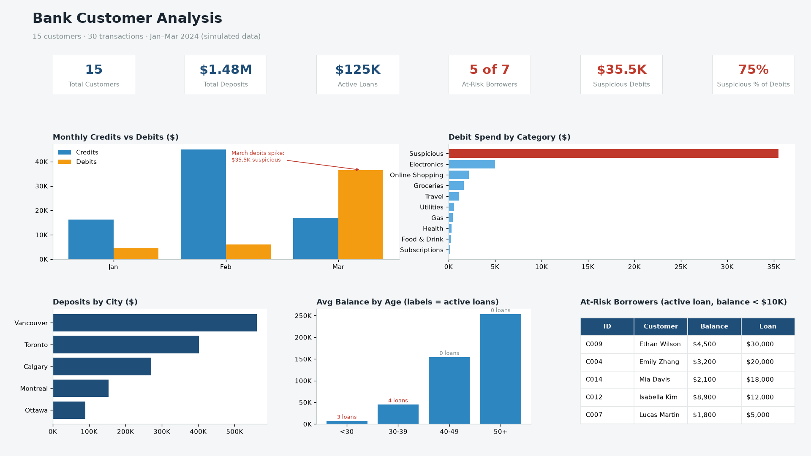

# Bank-Customer-Analysis
A data analysis portfolio project using a simulated bank customer dataset. Covers SQL querying and a Power BI dashboard to pull out balance concentration, loan risk and suspicious-activity insights.

## Key Findings
- **Deposits are highly concentrated:** the top 3 customers hold $970,500 of $1,477,550 in total deposits (**65.7%**). Losing one of them would remove up to 30% of the deposit base.
- **Savings vs Checking gap:** Savings accounts average **$160,517** vs **$5,483** for Checking (about 29x). All 6 Checking customers have balances under $12,500.
- **Loan risk sits with younger customers:** all **7 active loans** belong to customers under 40, while customers aged 40+ average **$203,708** in deposits and have no active loans.
- **5 of 7 active borrowers are at risk** (active loan with balance under $10,000). They account for **$85,000 of $125,000** in active loans (**68%**) but hold only $20,500 in deposits.
- **Suspicious activity drives March:** 3 transactions to "Unknown Vendor" total **$35,500**, which is **75% of all debit spend** in the quarter. All 3 happened in March, pushing March debits to $36,565 (vs $4,650 in January).
- **The original fraud rule misses cases:** Query 5 (`amount > $10,000`) catches only 2 of the 3 suspicious transactions. The missed one (T023, $5,500) is the riskiest: customer C009 spent more than their $4,500 balance and holds the largest active loan ($30,000). Query 6 fixes this.
- **Vancouver leads deposits:** $561,150 across 3 customers (38% of total), with the highest average balance by city ($187,050).

## Recommendations
- Flag suspicious transactions by category and by **amount relative to balance**, not a fixed $10,000 threshold.
- Prioritise review of C009 (suspicious debit larger than balance, $30K active loan).
- Monitor the 5 at-risk borrowers for missed payments; consider savings incentives for under-40 Checking customers.
- Build retention plans for the top 3 depositors given the concentration risk.

## Power BI Dashboard
Files in [`powerbi/`](powerbi):

| File | Purpose |
|---|---|
| `power_query.m` | Power Query (M) scripts to load and type both CSVs, plus `full_name`, `tenure_years` and `month` columns |
| `measures.dax` | DAX measures: deposits, active loans, at-risk borrowers and exposure, top-3 concentration, credits/debits, suspicious share, large-debit flag |
| `bank_theme.json` | Report colour theme |
| `dashboard_preview.png` | Preview of the report page layout (rendered from the same data) |

**Data model:** `bank_customers` (1) → `bank_transactions` (*) on `customer_id`.

**Report page:**
- KPI cards: Total Customers, Total Deposits, Active Loans, At-Risk Borrowers, Suspicious Debits, Suspicious % of Debits
- Clustered column: monthly Credits vs Debits
- Bar: debit spend by category (Suspicious highlighted)
- Bar: deposits by city
- Column: average balance by age group, with active loan counts
- Table: at-risk borrowers (active loan, balance < $10K)

**To rebuild:** open Power BI Desktop → Get Data → Blank Query → paste each script from `power_query.m` (update `FolderPath`) → create the relationship → add measures from `measures.dax` → View → Themes → Browse for themes → `bank_theme.json`.

## SQL Queries
`bank_analysis_queries.sql` (SQLite syntax):
1. Top 5 customers by balance
2. Monthly transaction totals (credits vs debits)
3. Active loans with balance under $10,000
4. Average balance by account type
5. Large suspicious transactions (> $10,000)
6. All suspicious transactions with the customer's loan exposure

## Dataset Overview

### `bank_customers.csv`
| Column | Description |
|---|---|
| `customer_id` | Unique customer identifier |
| `first_name` / `last_name` | Customer name |
| `age` / `gender` / `city` | Demographics |
| `account_type` | Savings or Checking |
| `account_balance` | Current balance (CAD) |
| `loan_amount` | Outstanding loan (0 if none) |
| `loan_status` | Active / Paid Off / No Loan |
| `account_open_date` | Date account was opened |

### `bank_transactions.csv`
| Column | Description |
|---|---|
| `transaction_id` | Unique transaction ID |
| `customer_id` | Links to customer table |
| `transaction_date` | Date of transaction |
| `transaction_type` | Credit or Debit |
| `amount` | Transaction amount (CAD) |
| `merchant` | Merchant or source name |
| `category` | Spending category |

## Tools Used
- SQL (SQLite)
- Power BI (Power Query, DAX)
- Python (matplotlib) for the dashboard preview image
